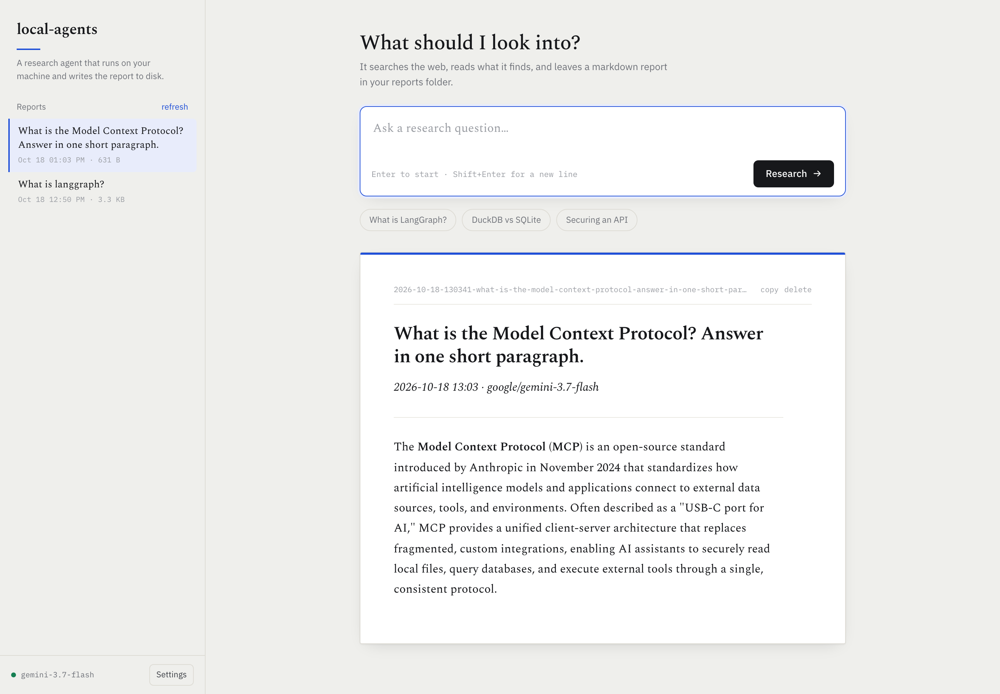

# local-agents

A free research agent you run locally. Ask a question, it searches the web and
writes you a markdown report — with a small app to browse everything it has
written.

```bash
agents                        # opens the app in your browser
agents "what is langgraph?"   # or ask straight from the terminal
```



Built on [Deep Agents](https://docs.langchain.com/oss/python/deepagents/overview).
Costs **$0** to run: a free Gemini key for the model, keyless DuckDuckGo/Bing
for search. Optional extras (Tavily, a local Ollama model) if you want them.

---

## Quickstart

```bash
git clone https://github.com/JSA30/local-agents.git
cd local-agents
uv sync
cp .env.example .env
```

Get a free key at <https://aistudio.google.com/apikey> and add it to `.env`:

```dotenv
PROVIDER=google
GOOGLE_API_KEY=AIza...
```

Run it:

```bash
uv run research_agent.py "what is langgraph?"
```

### Make it a command (recommended)

```bash
ln -s "$PWD/bin/agents" ~/.local/bin/agents   # or any directory on your PATH
```

Then, from anywhere:

```bash
agents                           # opens the app in your browser
agents "what is langgraph?"      # ask anything, straight from the terminal
agents --ui                      # open the app
agents --check                   # verify setup, no model calls
agents --ping                    # test the model with one tiny call
agents --help                    # full usage
```

## The app

`agents` on its own opens a local web app — the same terminal flow, but you can
watch the run and read the result in one place.

- **Ask** a question and watch the tool calls stream in as the agent works.
- **Read** the finished report, rendered from the markdown on disk.
- **Browse** every past report from the sidebar and reopen any of them.
- **Change** provider, model, and API keys from the settings panel — no hand
  editing `.env`.

It is a single FastAPI process on `127.0.0.1:8765`, serving one static page.
Each question is run by spawning the same CLI you would get from
`agents "question"`, so there is one implementation of the agent and every run
picks up your current config. Nothing listens on a public interface and no data
leaves your machine except the model and search calls.

The terminal flow is still fully supported — `agents "question"` prints the
same trace and writes the same report.

## What you get

Tool calls stream as they happen, so you can watch it search and reason. Every
run is saved so nothing is lost:

```
~/research-reports/2026-10-18-125026-what-is-langgraph.md
```

Each file records the question, the timestamp, the model used, and the full
report. Change the location with `REPORTS_DIR`.

Beyond the search tool, you get everything `create_deep_agent` ships with: file
system tools (`ls`, `read_file`, `write_file`, `edit_file`, `glob`, `grep`), a
`task` tool that spawns subagents in isolated context windows, and automatic
offloading of large tool results.

## Configuration

All optional — the defaults work with nothing but a Gemini key.

| Variable | Default | What it does |
| --- | --- | --- |
| `PROVIDER` | `google` | `google`, `ollama`, or `opencode` |
| `GOOGLE_API_KEY` | — | **required** when `PROVIDER=google` |
| `GOOGLE_MODEL` | `gemini-3.7-flash` | primary model |
| `GOOGLE_FALLBACKS` | `gemini-3.5-flash-lite,gemini-3.8-flash` | tried when the primary is overloaded |
| `TAVILY_API_KEY` | — | optional; makes search far more reliable |
| `SEARCH_BACKENDS` | `duckduckgo,bing` | keyless engines, tried in order |
| `REPORTS_DIR` | `~/research-reports` | where reports are written |
| `OLLAMA_MODEL` | `gemma4:26b` | used when `PROVIDER=ollama` |
| `RETRIES_PER_MODEL` | `2` | attempts per model on transient errors |
| `SEARCH_CACHE_TTL` | `300` | seconds a search result is reused within a run |
| `SEARCH_ERROR_CACHE_TTL` | `60` | seconds a failed search is left alone before retrying |

## Why the defaults are what they are

Everything here was **measured, not guessed**. Each finding changed the design:

- **Gemini's built-in `google_search` grounding is not in the free tier.** It
  returns `429 RESOURCE_EXHAUSTED` while plain function tools work fine. Hence
  the DuckDuckGo fallback.
- **Free flash models go down in waves.** `503 UNAVAILABLE — high demand` can
  outlast the client SDK's own six retries, so a run retries and falls through
  to backup models. In practice the primary model frequently needs this.
- **DuckDuckGo rate-limits under bursty agent traffic.** Agents fire several
  searches within seconds. The tool retries, rotates engines, and returns an
  `{"error": ...}` dict instead of raising — a raised exception kills the run.
- **Only some `ddgs` backends actually work.** Verified: `duckduckgo` and `bing`
  return results. `brave`, `mojeek`, `startpage`, `google`, and `wikipedia`
  return "No results found"; `yahoo` times out.
- **`langchain-google-genai` returns message content as a list of blocks**, not
  a string. Anything reading `content` directly must handle both shapes.
- **A retry used to repeat every search.** A run that dies on congestion starts
  over, so search results are cached: successes for five minutes, failures for
  one, so a search that just timed out is not immediately retried.

## Better search (optional)

DuckDuckGo and Bing are free but thin — under a burst, both can throttle at once
and you get a thinner report. A free [Tavily](https://tavily.com) key (~1,000
searches/month) fixes that. When set, Tavily is tried first and the free engines
become the fallback:

```dotenv
TAVILY_API_KEY=tvly-...
```

## Run fully offline (optional)

```dotenv
PROVIDER=ollama
OLLAMA_MODEL=gemma4:26b
```

No key at all, and nothing leaves your machine. Slower and noticeably weaker at
tool discipline than Gemini — a local model once tried `read_file` on a URL
instead of searching. Use a model that supports tool calling.

## Why not some other options

- **opencode free tier** → `403 FreeTierError`. Free models are restricted to
  the opencode app and refuse external scripts.
- **DeepSeek V4.1 Flash / V4 Pro locally** → not practical. MIT-licensed and
  free, but ~552B / 1.6T parameters, so roughly 380–800 GB even at 4-bit.
  Ollama serves them only as `:cloud` tags (hosted, account required).

## Trace with LangSmith (optional)

Off by default.

```dotenv
LANGSMITH_TRACING=true
LANGSMITH_API_KEY=lsv2-...
```

## License

MIT — see [LICENSE](LICENSE).
